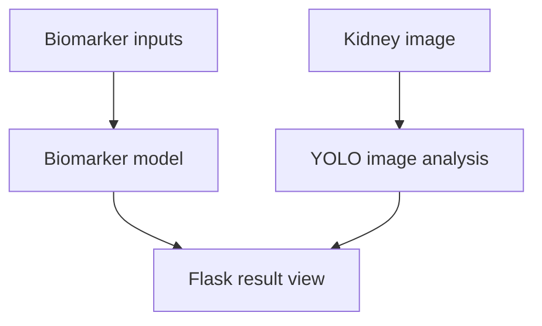
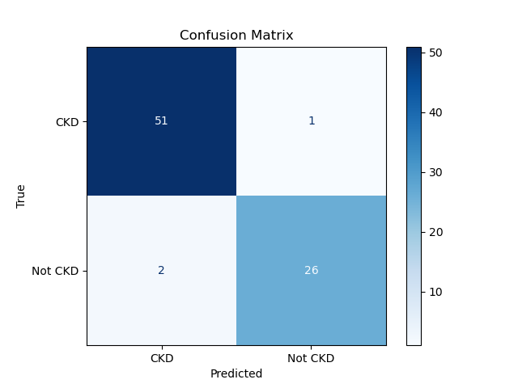

# Renal Failure Prediction
**Biomarker modelling · Kidney-image analysis · PyTorch · Flask**

An academic project exploring two sources of information: **24 biomarker features** and **kidney CT images**. It includes classical model comparisons, a biomarker CNN, YOLO image analysis and a Flask interface that presents both outputs.

[Analysis report](reports/biomarker-notebook-export.pdf) · [Application code](project/) · [Recorded results](docs/RESULTS.md) · [Demonstration guide](docs/DEMO.md)

## Work included

- Preparing biomarker data and comparing Decision Tree, KNN, Logistic Regression and Random Forest.
- Training and evaluating a PyTorch biomarker CNN.
- Analysing kidney images with an uploaded YOLO checkpoint.
- Connecting both workflows to forms, image uploads and result views in Flask.

## Workflow



The interface presents both outputs together. This demonstrates workflow integration; it does not establish a calibrated joint multimodal prediction model.

## Recorded biomarker comparison

| Model | Saved test accuracy |
|---|---:|
| Random Forest | **98.75%** |
| Logistic Regression | 97.50% |
| Decision Tree | 96.25% |
| KNN | 93.75% |

These are historical results from the uploaded ML logs copy experiment. [Source tables and context](docs/RESULTS.md).

## Original experiment visuals

### Classical model comparison


### Biomarker CNN evaluation


[Classification report](runs_epoch100/classification_report_epoch100.txt) · [Loss curve](runs_epoch100/LOSS_curve_epoch100.png) · [Model-specific results](Codes/ML%20logs%20copy/models/)

## Repository guide

| Location | Contents |
|---|---|
| [project/](project/) | Flask interface, templates, inference utilities and app checkpoints |
| [Codes/](Codes/) | Original biomarker notebooks, data and model comparisons |
| [Fusion.ipynb](Fusion.ipynb) | Maintained combined-workflow notebook |
| [runs_epoch30/](runs_epoch30/) / [runs_epoch100/](runs_epoch100/) | Saved CNN experiment evidence |
| [reports/](reports/) | Uploaded notebook PDF export |
| [archive/](archive/) | Original fusion notebook and uploaded app ZIP |
| [docs/](docs/) | Results, walkthrough and technical notes |

## Related research

[Enhanced Deep Learning Models for Early Detection of Renal Failure from CT Imaging](https://doi.org/10.69888/FTSHSL.2024.000251).

The repository contains related project artifacts; an exact reproduction of every published result has not been verified.

<details>
<summary>Setup and future work</summary>

```bash
python -m pip install -r requirements.txt
python project/app.py
```

This is an academic research demonstration, not a clinically validated diagnostic system. Seven input/route regression tests pass with model inference mocked. Full checkpoint-backed inference remains to be verified.

Future work: restore dataset provenance, verify model environments and rerun the selected checkpoints.

[Demo instructions](docs/DEMO.md) · [Implementation notes](docs/REPAIRS.md) · [Initial review](docs/REPRODUCIBILITY.md)
</details>
